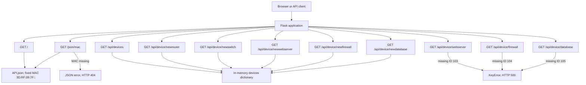

# Flask App Project Reference

This README records the current application behavior as a starting point for future development. Keep the route inventory and diagram in sync with `app.py` whenever endpoints change.

## Application Overview

The Flask application exposes network-device data from two sources:

* `API.json` contains records keyed by MAC address. `app.py` loads it when the module starts.
* The in-memory `devices` dictionary contains device IDs 106 through 110. Changes to it are lost when the process restarts.

The declared dependency is Flask 3.1.3 (see `req.txt`). Run the development server with `python app.py` after installing the requirements.

## Routes

All routes currently accept `GET` requests. `{mac}` is a path parameter, not a query parameter.

| Method | URL | Behavior and response |
| --- | --- | --- |
| `GET` | `/` | Returns the `API.json` record for MAC `3D:RF:09:7F::` as JSON. |
| `GET` | `/json/<mac>` | Returns the matching `API.json` device record as JSON; returns `{"error":"MAC no encontrada"}` with HTTP 404 when the MAC is absent. |
| `GET` | `/api/devices` | Returns the complete in-memory `devices` dictionary (IDs 106-110) as JSON. |
| `GET` | `/api/device/webserver` | Intended to return the web server, but currently raises `KeyError` for missing ID 103 and responds HTTP 500. |
| `GET` | `/api/device/firewall` | Intended to return the firewall, but currently raises `KeyError` for missing ID 104 and responds HTTP 500. |
| `GET` | `/api/device/database` | Intended to return the database server, but currently raises `KeyError` for missing ID 105 and responds HTTP 500. |
| `GET` | `/api/device/newrouter` | Returns device 106 (secondary router) as JSON. |
| `GET` | `/api/device/newswitch` | Returns device 107 (backup switch) as JSON. |
| `GET` | `/api/device/newwebserver` | Returns device 108 (backup web server) as JSON. |
| `GET` | `/api/device/newfirewall` | Returns device 109 (secondary firewall) as JSON. |
| `GET` | `/api/device/newdatabase` | Returns device 110 (backup database server) as JSON. |

The three legacy endpoints above refer to IDs 103-105, which are not initialized in `devices`; update those lookups or seed the expected IDs before relying on them.

## Route Map

## Git Branches

Branch inventory observed while preparing this reference:

| Location | Branch | State |
| --- | --- | --- |
| Local | `feature-FlaskV01` | Active branch; this is the branch to publish. |
| Local | `feature/FlaskV01` | Existing local branch with a separate commit. |
| Origin | `feature` | Remote branch; currently points to the same commit as the other listed origin branches. |
| Origin | `hotfix` | Remote branch; currently points to the same commit as the other listed origin branches. |
| Origin | `main` | Remote branch; currently points to the same commit as the other listed origin branches. |
| Origin | `patch` | Remote branch; currently points to the same commit as the other listed origin branches. |
| Origin | `release` | Remote branch; currently points to the same commit as the other listed origin branches. |
| Origin | `release2` | Remote branch; currently points to the same commit as the other listed origin branches. |
| Origin | `release3` | Remote branch; currently points to the same commit as the other listed origin branches. |

The repository does not define branch policies. Suggested roles, based on branch names only: use `main` for stable code, `feature` for feature integration, `hotfix` for urgent fixes, `patch` for maintenance, and `release*` for release preparation. Use a feature-specific branch for app work and merge it through the team's chosen review process. Confirm these roles with the maintainers before treating them as policy.

## Updating This Reference

When changing the application, verify each route's method, exact URL, source data, and success/error behavior against `app.py`. Then update both the Routes table and Route Map. Recheck the branch inventory when branch names or policies change.